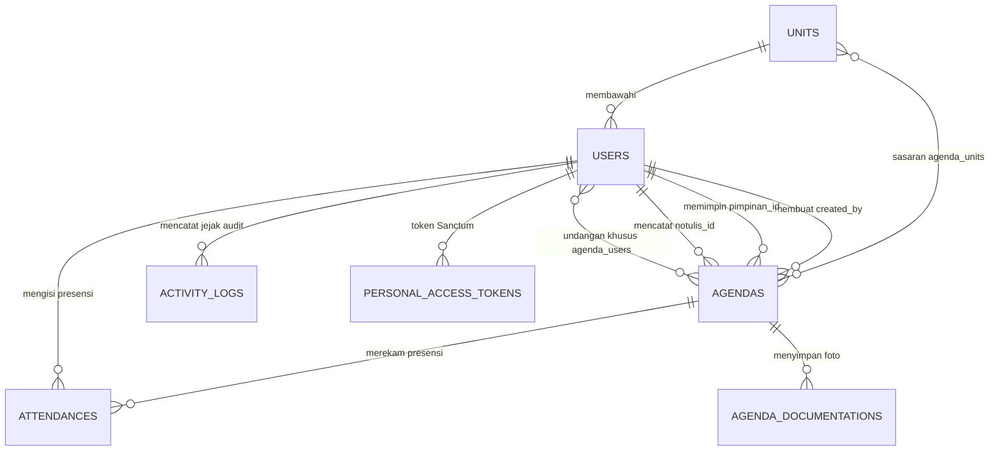

# SIPERAPAT - Sistem Informasi Presensi & Rapat Kedinasan

**Lembaga Layanan Pendidikan Tinggi (LLDIKTI) Wilayah X**  
*Kementerian Pendidikan Tinggi, Sains, dan Teknologi Republik Indonesia*

---

## 1. Ringkasan Sistem

**SIPERAPAT** mendigitalkan tata kelola rapat kedinasan di lingkungan LLDIKTI Wilayah X, mulai dari penjadwalan agenda, penerbitan surat undangan/edaran, verifikasi kehadiran biometrik, penyusunan notulensi, hingga pelaporan resmi (PDF, DOCX, CSV) melalui dua antarmuka:

1. **Aplikasi Web (Laravel 13 + Blade + Tailwind CSS v4):** Portal operasional penuh untuk manajemen agenda, editor naskah Surat Edaran Digital, kustomisasi Berita Acara, pemantauan kehadiran, serta administrasi pengguna dan unit kerja.
2. **REST API Mobile v1 (Laravel Sanctum):** Layanan *stateless JSON API* (`/api/v1`) yang melayani aplikasi klien Android/iOS (`siperapat` React Native / Expo).

---

## 2. Arsitektur, Infrastruktur & Standar Keamanan

* **Arsitektur Native Laravel 13:** Memaksimalkan *Policies*, *Form Requests*, *Eloquent Scopes*, *Custom Casts*, dan *Service Classes* (`AgendaService`, `AttendanceService`, `AttendanceMetricsService`, `PdfExportService`, `DocxExportService`) tanpa package eksternal yang redundan.
* **Integritas Transaksi & Konkurensi:**
  * Operasi mutasi berantai (presensi, unggah berkas, pencatatan log audit) dibungkus dalam `DB::transaction()`.
  * Deteksi bentrok ruang rapat menggunakan kolom ternormalisasi (`lokasi_ruang_normalized`) serta *advisory lock* database (`pg_advisory_lock` di PostgreSQL / `GET_LOCK` di MySQL).
  * Validasi keselarasan zona waktu aplikasi dan sesi database (`Asia/Jakarta` / WIB) saat *boot* di `AppServiceProvider`.
* **Isolasi & Privasi Media Biometrik:**
  * Swafoto wajah dan tanda tangan digital disimpan pada disk privat `local` (`storage/app/private`) dengan fallback disk `public` untuk rekaman lama, lalu disajikan melalui endpoint streaming terotorisasi (`AttendanceMediaController` & `/api/v1/attendances/{attendance}/selfie|signature`).
  * Sesuai `AttendancePolicy::view`, media biometrik hanya dapat dilihat oleh pemilik presensi sendiri, **Administrator**, **Pimpinan Rapat (`pimpinan_id`)**, dan **Admin Unit terkait**. Pengguna tanpa kewenangan (seperti staf biasa atau notulis non-pimpinan) menerima lencana privasi (`x-biometric-privacy-badge`) alih-alih tautan gambar terblokir.
* **Status Akun Aktif (`EnsureAccountIsActive`):** Penonaktifan akun langsung memblokir akses Web (invalidate session) serta API (`403` dengan `code: ACCOUNT_INACTIVE`) dan mencabut seluruh token Sanctum aktif.

### Mode Cache, Session & Queue: Non-Redis vs Redis

Aplikasi dapat dijalankan dengan atau tanpa Redis melalui pengaturan `.env`:

| Komponen | Mode Non-Redis (Default) | Mode Redis (Opsional Skala Tinggi) | Catatan Teknis |
|---|---|---|---|
| **Session Web** | `SESSION_DRIVER=database` | `SESSION_DRIVER=redis` | Default menyimpan sesi di tabel `sessions`. |
| **Cache & Rate Limit** | `CACHE_STORE=database` | `CACHE_STORE=redis` | Redis disarankan bila trafik presensi/API padat agar mengurangi query tabel `cache`. |
| **Antrean Job** | `QUEUE_CONNECTION=database` | `QUEUE_CONNECTION=redis` | Memakai tabel `jobs` pada mode default; driver `phpredis` (`REDIS_CLIENT=phpredis`) bila memakai Redis. |
| **Lock Jadwal Rapat** | Advisory lock DB (`pg_advisory_lock` / `GET_LOCK`) | Tetap di DB | Independen dari Redis agar atomik bersama transaksi database. |

---

## 3. Skema & Relasi Database Inti

Seluruh tabel relasional dipelihara melalui 25 berkas migrasi di `database/migrations/` (mendukung PostgreSQL 15+, MySQL 8.0+/MariaDB 10.11+, serta SQLite untuk uji lokal).



### Kamus Entitas Utama

| Tabel | Peran Utama & Relasi | Aturan Integritas Kunci |
|---|---|---|
| `units` | Master bagian / Pokja (`kode_unit`, `nama_unit`, `is_active`). | `kode_unit` unik; mencegah penghapusan unit yang masih memiliki pegawai/agenda aktif. |
| `users` | Akun ASN (`nip`, `username`, `email`, `role`, `unit_id`, `is_active`). | `nip`, `username`, dan `email` unik; relasi opsional `unit_id` (null untuk level lembaga). |
| `agendas` | Data inti rapat (`slug`, `judul_rapat`, `tipe_rapat`, `waktu_mulai`, `waktu_selesai`, `target_type`, `status`, `pimpinan_id`, `notulis_id`, `surat_edaran_type`, `report_config`). | `slug` unik; `waktu_selesai` boleh `null` untuk mode **"Hingga Selesai"**; `lokasi_ruang_normalized` & indeks komposit menjaga jadwal bebas bentrok ruang. |
| `agenda_units` | Tabel pivot sasaran unit pada `target_type = selected_units`. | Kunci unik gabungan `(agenda_id, unit_id)`. |
| `agenda_users` | Tabel pivot sasaran pegawai tertentu pada `target_type = selected_users`. | Kunci unik gabungan `(agenda_id, user_id)`. |
| `attendances` | Rekam presensi (`signed_at`, `selfie_path`, `signature_path`, `ip_address`, `user_agent`). | Kunci unik gabungan `(agenda_id, user_id)` mencegah presensi ganda; FK `user_id` bersifat `restrictOnDelete`. |
| `agenda_documentations` | Foto dokumentasi rapat (`file_path`, `caption`, `sort_order`). | Cascade delete saat agenda dihapus. |
| `activity_logs` | Log audit aktivitas sistem (`activity_type`, `target_model`, `target_id`, `properties`). | Terindeks pada `(activity_type, created_at)` dan dipangkas berkala oleh `activity-logs:prune`. |

---

## 4. Matriks Hak Akses (3 Peran & Delegasi Rapat)

SIPERAPAT membagi otorisasi ke dalam 3 level peran (`administrator`, `admin`, `staff`) ditambah delegasi tugas rapat (`pimpinan_id` dan `notulis_id`):

| Kemampuan / Modul | Administrator | Admin Unit (`admin`) | Staff (`staff`) |
|---|---|---|---|
| **Kelola Master Unit Kerja** | Penuh (CRUD + toggle status) | Lihat unit sendiri | Tidak tersedia |
| **Kelola Pengguna ASN** | Penuh seluruh unit | Unit sendiri (tidak bisa ubah/hapus Administrator) | Hanya sunting profil sendiri |
| **Buat / Edit / Hapus Agenda** | Semua unit | Unit penyelenggara / dibuat sendiri; edit delegasi Pimpinan/Notulis saat `ongoing` | Tidak tersedia |
| **Tambah Peserta ASN Ad-Hoc** | Semua agenda `scheduled` / `ongoing` | Agenda pembuat / unit penyelenggara saat `scheduled` / `ongoing` | Khusus **Pimpinan (`pimpinan_id`)** pada rapat `scheduled` / `ongoing` |
| **Ubah Status Rapat** | Semua agenda | Agenda unit penyelenggara / dibuat sendiri, atau saat bertugas di `ongoing` | Tidak tersedia |
| **Kelola Notulensi & Foto Dokumentasi** | Semua agenda (kecuali `cancelled`) | Pembuat / Admin Unit penyelenggara; jika ditunjuk Pimpinan/Notulis khusus saat `ongoing` | Khusus **Pimpinan (`pimpinan_id`)** atau **Notulis (`notulis_id`)** saat rapat `ongoing` |
| **Isi Presensi Rapat** | Semua agenda `ongoing` | Agenda yang menjadi sasarannya | Agenda yang menjadi sasarannya |
| **Lihat Swafoto & TTD Peserta Lain** | Semua agenda | Agenda terkait (pembuat, unit penyelenggara, unit peserta, sasaran, atau `all_units`) | Hanya milik sendiri, **kecuali bila ditunjuk sebagai Pimpinan Rapat (`pimpinan_id`)** |
| **Rekap Laporan & Ekspor (PDF/DOCX/CSV)** | Seluruh instansi | Terlingkup unit sendiri / agenda yang dapat diakses | Tidak tersedia |
| **Log Aktivitas Sistem (Audit Trail)** | Seluruh pengguna (`activity-logs`) | Log aktivitas pribadi saja | Log aktivitas pribadi saja |

---

## 5. Tech Stack

| Lapisan | Teknologi & Versi |
|---|---|
| **Backend** | PHP `^8.3` (8.3 / 8.4), Laravel `^13.8`, Laravel Sanctum `^4.3` |
| **Frontend Web** | Laravel Blade, Tailwind CSS v4 (`@tailwindcss/vite ^4.0.0`), Vite `^8.0.0`, Vanilla JS |
| **Ikon Antarmuka** | SVG murni (Heroicons / Phosphor style) |
| **Basis Data** | PostgreSQL 15+ (utama produksi), MySQL 8.0+ / MariaDB 10.11+, SQLite 3.35+ |
| **Ekspor Dokumen** | `dompdf/dompdf` (`^3.1`) untuk PDF, `phpoffice/phpword` (`^0.18.3`) untuk DOCX, CSV UTF-8 BOM |
| **Email Transaksional** | Brevo SMTP Relay (`465` Implicit TLS / `587` STARTTLS) & Brevo HTTP API v3 (`443` HTTPS) |
| **Pengujian** | PHPUnit `^12.5.12` |

---

## 6. Fitur Inti Sistem

* **Autentikasi & Pemulihan Sandi Multi-Identifier:** Login memakai **NIP (18 digit)** atau **Username** dan langsung mengarahkan ke Dashboard tanpa notifikasi pop-up sambutan yang menghalangi tampilan. Pemulihan sandi menerima NIP, Username, atau Email Kedinasan dengan pengiriman tautan reset via Brevo serta pencabutan seluruh token aktif saat sandi diperbarui.
* **Siklus Status, Jadwal Paralel & Validasi Bentrok:** State machine tervalidasi (`draft` -> `scheduled` -> `ongoing` -> `completed` / `cancelled`) dengan dukungan jadwal selesai spesifik maupun opsi **"Hingga Selesai"** (`waktu_selesai = null`). Sistem mendukung opsi jadwal bersamaan (`allow_schedule_overlap`) untuk agenda paralel lintas unit/personel sambil tetap memblokir bentrok ruangan fisik yang sama dan waktu lampau. Sesi presensi dibuka paling cepat 15 menit sebelum waktu mulai (`AGENDA_START_WINDOW_MINUTES`) dan ditutup otomatis setiap menit oleh scheduler `php artisan agendas:sync-status` setelah melewati batas akhir plus masa tenggang (`AGENDA_CLOSE_GRACE_MINUTES`).
* **3 Mode Sasaran Peserta & Penambahan Ad-Hoc:** Seluruh unit (`all_units`), unit kerja terpilih (`selected_units`), atau pegawai ASN tertentu (`selected_users`), dilengkapi delegasi lintas unit untuk **Pemimpin Rapat (`pimpinan_id`)** dan **Notulis (`notulis_id`)**. Pada rapat `scheduled` maupun `ongoing`, Administrator, Admin Unit penyelenggara, dan Pimpinan Rapat dapat menambahkan ASN ekstra secara ad-hoc (`agenda_users`) tanpa menimpa daftar unit peserta.
* **Surat Edaran Hibrida:** Mendukung unggahan berkas resmi (`upload`: PDF/gambar maks. 5 MB) serta penyusunan naskah digital langsung di portal web (`digital`) yang dapat diekspor ke PDF dan DOCX.
* **Presensi Multimodal:** Kompresi swafoto di sisi klien (batas server 512 KB), kanvas tanda tangan digital PNG, dan tanda terima kehadiran digital.
* **Notulensi, Dokumentasi & Pelaporan:** Editor notulensi/kesimpulan bersanitasi XSS, galeri foto dokumentasi (maks. 10 foto per unggahan, @4 MB), analitik partisipasi unit & ASN berbasis `AttendanceMetricsService`, serta ekspor Berita Acara (PDF A4 dan DOCX valid ZIP dengan lampiran **II. Daftar Kehadiran Peserta** dimulai pada halaman baru, CSV daftar hadir, dan CSV ringkasan 13 kolom berproteksi formula injection).
* **Audit Trail Sistem:** Pencatatan aktivitas sensitif pada `activity_logs` dengan pemangkasan log di atas 730 hari melalui `php artisan activity-logs:prune`.

---

## 7. Instalasi, Konfigurasi & Pemeliharaan

### Prasyarat
* PHP `>= 8.3` dengan ekstensi `pdo_pgsql` / `pdo_mysql`, `gd`, `zip`, `mbstring`, `fileinfo` (tambahkan ekstensi `redis` jika mengaktifkan mode Redis)
* Composer 2.x, Node.js 20 LTS + NPM
* PostgreSQL 15+ (disarankan) atau MySQL 8.0+ / MariaDB 10.11+

### Langkah Setup Lokal
```bash
# 1. Pasang dependensi PHP & frontend
composer install
npm install

# 2. Siapkan environment lokal dan application key
cp .env.example .env
php artisan key:generate

# 3. Sesuaikan koneksi DB_* dan MAIL_* pada .env, lalu jalankan migrasi & seeder resmi
php artisan migrate --seed
php artisan storage:link

# 4. Sinkronkan sequence primary key jika memakai PostgreSQL
php artisan pgsql:sync-sequences

# 5. Bangun aset frontend dan jalankan server lokal
npm run build
php artisan serve
```

### Variabel Environment Kunci (`.env`)

| Variabel | Default | Fungsi |
|---|---|---|
| `DB_CONNECTION` | `pgsql` | Mesin database utama (`pgsql` / `mysql` / `mariadb`). |
| `SESSION_DRIVER` / `CACHE_STORE` / `QUEUE_CONNECTION` | `database` | Ubah serentak ke `redis` bila memakai Redis server. |
| `AGENDA_START_WINDOW_MINUTES` | `15` | Batas menit sebelum `waktu_mulai` rapat boleh diubah ke `ongoing`. |
| `AGENDA_CLOSE_GRACE_MINUTES` | `15` | Toleransi menit setelah `waktu_selesai` sebelum `agendas:sync-status` menutup rapat. |
| `SANCTUM_EXPIRATION` | `43200` | Masa aktif token API Mobile dalam menit (43.200 = 30 hari). |
| `MAIL_MAILER` / `MAIL_PORT` | `smtp` / `465` | Pengiriman email reset sandi via Brevo SMTP (`465` SSL / `587` TLS) atau `brevo` (API HTTPS `443`). |

### Data Awal Resmi (`DatabaseSeeder`)
`DatabaseSeeder` hanya mengisi master data resmi instansi agar siklus agenda dimulai dari kondisi bersih (*zero-agenda state*):
* **`UnitSeeder`:** 12 entitas unit kerja resmi LLDIKTI Wilayah X.
* **`UserSeeder`:** 69 akun pegawai ASN resmi aktif (kata sandi awal `Password123!`), terdiri dari **1 Administrator Utama Sistem** (`apandi`, NIP `198804022019031016`) dan **68 Pegawai ASN** pada unit kerjanya masing-masing.

Untuk simulasi atau uji beban non-produksi, jalankan seeder/generator agenda secara eksplisit:
```bash
# Mengisi contoh agenda beserta sampel presensi
php artisan db:seed --class=AgendaSeeder

# Atau membangkitkan agenda simulasi kustom (aman di --no-dev)
php artisan agenda:generate 20 --attendees=15
```

### Perintah Pemeliharaan, Cron & Pengujian
```bash
# Menjalankan Unit Test terisolasi (tanpa ketergantungan koneksi DB)
php artisan test --testsuite=Unit

# Menjalankan seluruh test suite (membutuhkan database uji terisolasi di .env / .env.testing)
php artisan test

# Diagnostik pengiriman email Brevo (SMTP / HTTP API)
php artisan mail:test tujuan@domain.go.id

# Scheduler otomatis (daftarkan `php artisan schedule:run` pada cron per menit)
php artisan agendas:sync-status
php artisan activity-logs:prune --days=730
```

> **Catatan Database Uji:** `Tests\TestCase` memakai `DatabaseTransactions` dan menolak eksekusi apabila nama database aktif bukan database uji terisolasi (mis. mengandung `test` atau `sqlite`).

---

## 8. Panduan Kendala Umum (FAQ Teknis)

* **Mengapa status rapat belum bisa diubah ke `Sedang Berlangsung`?**  
  Server memvalidasi pembukaan rapat paling cepat `AGENDA_START_WINDOW_MINUTES` (bawaan **15 menit**) sebelum `waktu_mulai`. Pastikan jam server dan koneksi database konsisten pada `Asia/Jakarta`.
* **Mengapa foto swafoto atau tanda tangan peserta tidak muncul bagi sebagian akun?**  
  Media biometrik disimpan pada disk privat `local` dan hanya dibuka bagi pemilik presensi, Administrator, Pimpinan Rapat, dan Admin Unit terkait (`AttendancePolicy::view`). Pengguna lain melihat lencana *Dilindungi Privasi*.
* **Mengapa email lupa kata sandi gagal terkirim di VPS?**  
  Beberapa provider VPS memblokir port SMTP keluar (`587`). Gunakan Port `465` (`MAIL_SCHEME=smtps`, `MAIL_ENCRYPTION=ssl`) atau beralih ke Brevo HTTP API (`MAIL_MAILER=brevo` via HTTPS port `443`), lalu uji dengan `php artisan mail:test`.

---

## 9. Dokumentasi Terpublikasi Terkait

* **[API.md](API.md):** Kontrak resmi REST API v1 (`/api/v1`), autentikasi Sanctum, kebijakan media biometrik, rate limiter, serta skema parameter/respons untuk klien mobile.
* **Repositori Klien Mobile (`siperapat`):** Dokumentasi antarmuka Android/Expo, alur peran di aplikasi, dan setup klien tersedia pada berkas `README.md` di repositori `siperapat`.
